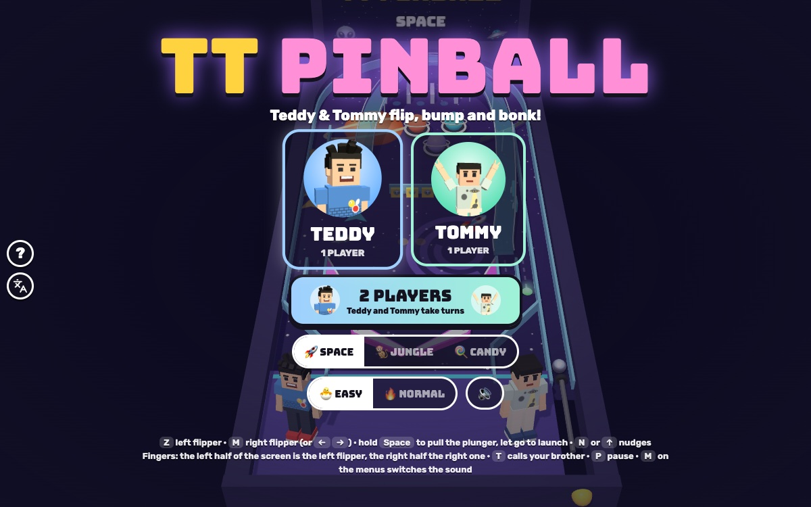

# TT Pinball

[](https://adong.github.io/pinball-tt/)

Press **?** any time (or tap the round **?** button on the left edge) to see the keys. The game waits while you look.
Tap the language button under it (the A文 icon) to switch between English and 中文; the dashboard and every game remember the choice.

**中文：** 3D 弹珠台：Teddy 和 Tommy 站在台子前面，用挡板把弹珠打上坡道、撞弹跳柱、打倒靶子，还有多球！三张台子：太空、丛林、糖果，单人或双人轮流玩。

A 3D pinball game starring Teddy and Tommy, built with Claude Code from plain JavaScript and Three.js, in the same
style as Metro Surfer and the other Teddy & Tommy games. The brothers stand on the front of the table like toy figures
while you play. There are no image, model or audio files: every table is built from boxes, cylinders and
canvas-painted pictures, the kids come from the shared kit (`kit/`), and every sound is synthesised.

The name lives in one place, [js/title.js](js/title.js). "TT Pinball" is a working title until Alan names it.

## Play

- **Double-click `index.html`.** It works offline, because Three.js and the kit are copied into `kit/`. Without
  internet the logo falls back from the Bungee font to Arial Black.
- **Send one file:** `dist/pinball-tt.html` is the whole game in one page (about 830 KB). Rebuild it after any edit:
  `python3 kit/tools/bundle.py . --name pinball-tt`
- **Get kit updates** from `~/claude-games/kit`: `python3 ../kit/tools/sync.py .`, then rebuild.
- **On the title screen** tap TEDDY or TOMMY (1 player) or 2 PLAYERS, pick a table (🚀 SPACE, 🐒 JUNGLE, 🍭 CANDY)
  and 🐣 EASY (the default) or 🔥 NORMAL. Behind the menu the autopilot plays the table you picked.
- **Three balls each.** Pull the plunger back (hold Space, or hold a finger down) and let go to launch. A gentle pull
  still gets the ball into play; a full pull sends it round the top and through the spinner.
- **The end:** GREAT GAME! (or "TEDDY WINS!" in 2 players), the scores and your best for that table and level, and the
  winner does his signature move on the apron with confetti: Teddy's Tyson-style boxing and his 🏀 jump shot, Tommy's
  Y with peace fingers. PLAY AGAIN starts the same table again.
- **Saved per browser:** the brother you picked, the table, EASY/NORMAL, and the best score for each table and level.

### EASY and NORMAL

| | 🐣 EASY (Tommy, 5) | 🔥 NORMAL (Teddy, 8) |
|---|---|---|
| flippers | longer: the gap between them closes, so nothing drains down the middle | standard |
| ball saver | 20 s after every launch (a drained ball comes straight back) | 8 s |
| kickbacks (outlanes) | always on, and they recharge after a second | lit by knocking down every drop target, one go each |
| table | a little slower (less slope) and gentler ramps | faster |
| MULTIBALL | 2 lights, then it starts as soon as the ball goes into a ramp | 3 lights, then make a ramp |
| TILT | 6 nudges close together; then no nudging for 4 s | 4 nudges; then the flippers nap for 3 s |

### 2 players

Teddy and Tommy take turns, a ball each (Teddy's ball 1, Tommy's ball 1, Teddy's ball 2...), with separate scores and
the same keys. Both stand on the apron, and the one whose turn it is stands a little bigger. A banner says whose turn
it is. The higher score wins.

## The tables

All three share the bottom half (two flippers, two slingshots, inlanes and outlanes with kickbacks), the shooter lane
and its one-way gate, the left orbit with a spinner, three rollover lanes at the top and a one-way guide that rolls
balls from the top right into the bumpers. The upper playfield is each table's own:

| table | bumpers | ramps | drop targets | standups |
|---|---|---|---|---|
| 🚀 Space | 3 planets with rings | ROCKET RAMP (left, back down to the right inlane) | 3 👽 in the middle | 2 ⭐ on the right wall |
| 🐒 Jungle | 3 drums | VINE RAMP (left, to the right inlane) and WATERFALL RAMP (right, to the left inlane) | 3 🐵 on the right | 2 🍌 on the left |
| 🍭 Candy | 4 cupcakes | CANDY CANE RAMP (middle, to the left inlane) | 3 🍬 | a 🧁 on each side |

### Scoring

| what | points |
|---|---|
| bumper | 100 |
| slingshot | 10 |
| spinner | 100 a half turn |
| rollover lane | 300; all three 3,000 and a MULTIBALL light |
| inlane | 100 |
| drop target | 500; the whole bank 5,000, a MULTIBALL light, and the kickbacks (NORMAL) |
| standup target | 1,000 |
| ramp | 2,000 and a MULTIBALL light |
| the glowing target (your brother's) | 5,000 more |
| MULTIBALL | two more balls from the plunger and a 12 s ball saver; every ramp is a JACKPOT, 10,000 |
| a treat from your brother | 100 |

### Nudge and TILT

Bump the table with N or ↑ (or the NUDGE button): every ball gets a little shove up and to one side, and the table
jumps. Nudge a few times close together and you hear CAREFUL!, then TILT (see the table above). It's gentle: you
never lose the ball for it.

## Controls

| | Keys | Touch |
|---|---|---|
| left flipper | Z or ← (or Left Shift) | the left half of the screen, or the ◀ pad |
| right flipper | M or → (or Right Shift) | the right half of the screen, or the ▶ pad |
| plunger | hold Space or ↓, let go to launch | while the ball waits on the plunger, hold any finger down, then let go |
| nudge | N or ↑ | NUDGE (bottom middle) |
| call your brother / high five | T or Enter | the round face button, top right |
| pause / sound | P or Esc / M on the menus (🔊 at the top while playing) | ❚❚ / 🔊 at the top |

The brief asked for the flippers on **Z and M**, and every Teddy & Tommy game uses **M for sound**. So while a ball is
in play M is the right flipper, and the sound switch is the 🔊 button at the top; on the title, pause and results
screens M switches the sound as usual. The ? panel says so too.

On the title: Enter or Space starts 1 player as the brother you picked last (← → to switch), 2 starts two players,
E switches EASY / NORMAL, ↑ ↓ change the table.

## Companion

In 1 player, call the other brother any time with **T** (or Enter, or his face button, top right), as often as you
like (`Kit.roster.buddyFor`, so it's Tommy for Teddy and Teddy for Tommy):

- He pops onto the apron beside you at his buddy size (Tommy is smaller) and does his signature move.
- He tosses you a treat (🍦 💧 🧃 🍪 🍉 🍌, +100): "🍪 COOKIE FROM TOMMY!"
- Then he helps: "TOMMY SAYS: BALL SAVER ON!" gives a 10-second ball saver (a bar under his button counts it down,
  and the 🛟 light between the flippers glows), and he lights a target with a big 👇 over it: hit it for 5,000 more.
- Call again while he's there for another treat, another 10 s and another lit target. When the saver runs out he
  waves bye.

In 2 players both brothers are already on the apron, so the button is a **HIGH FIVE**: both do their signature moves,
✋ ✋ and confetti.

## How it's checked

The rules and the physics live in [js/sim.js](js/sim.js) and [js/tables.js](js/tables.js) (no Three.js), so
`node tools/check.js` plays the real game headlessly (about 70 s; `--quick` about 20 s) and `game.check()` runs
the quick version in the page. Every check also runs a sabotaged version that must fail:

| check | what passes | the sabotage that must fail |
|---|---|---|
| soak | 240 balls at top speed (85) and 240 at twice that (170), on every table at both levels, flippers flapping: every step's path checked against every wall, post, bumper, slingshot and target and every flipper. Nothing escapes the table or passes through anything (about 540,000 pieces of path) | a mover without the swept test (move, then push out of overlaps) is caught going into a flipper or out of the table |
| autopilot | the autopilot (it flips when the ball reaches a flipper, and cradles slow balls and aims) keeps a ball alive 45 s or more on average on NORMAL with no ball saver (it manages well over a minute) | a bot that never flips: about 6 s |
| targets | every bumper, slingshot, drop and standup target, the spinner, the three lanes and every ramp is hit by the autopilot, on every table at both levels | a box of walls built round one target: that target is never hit |
| scoring | bumper, drop targets and the bank, ramps (and a weak shot rolling back out), spinner, the lit target, the ball saver, MULTIBALL and its jackpot, and 2-player turns in the right order | bumpers scoring nothing |
| frame rate | the same launch with the autopilot playing on ends with the same score and the ball in exactly the same place at 30, 60 and 120 frames a second | stepping by the frame time instead gives three different endings |
| plunger | every plunger power from 0 to 1 on every table puts the ball in play | |

How the physics never tunnels: the rules always step by 1/240 s (`PB.Runner` keeps the leftover time for the next
frame). Each step the ball finds the first thing it would touch along its path (walls and posts are capsules, bumpers
circles, flippers tapered capsules), stops there, bounces and carries on with the time that's left. A swinging
flipper is found by conservative advancement: the gap between the ball and the flipper can't close faster than the
ball's speed plus the flipper tip's speed, so stepping by gap / that speed never steps past the touch. The top speed
(85) is faster than a flipper's tip, so a flipper can never catch the ball again inside one swing. Ramps are a path
the ball rides on (it slows going up and either makes it over the top or rolls back out of the mouth).

Test hooks for the browser (the Browser pane throttles animation when hidden, so tests drive the game themselves):
`game.start(table, '1p' | '2p', hero, easy)`, `game.step(seconds)` (ticks and draws), `game.press(code)` /
`game.tap(code)`, `game.finger('L' | 'R', down)`, `game.launch(power)`, `game.call()`, `game.nudge()`,
`game.autopilot()`, `game.finish()`, `game.state()` and `game.check()`. `index.html?play&table=jungle&mode=2p` (or
`&hero=tommy&easy=0`) starts a game directly.

## Files

```
index.html       page, HUD, screens, touch pads (CSS inline)
js/title.js      the game's name (one constant)
js/tables.js     the three tables and the builder that turns one into collision shapes (no Three.js)
js/sim.js        the rules: swept ball physics, flippers, plunger, ramps, targets, MULTIBALL, ball saver, kickbacks,
                 nudge and TILT, turns, the companion and the high five, the autopilot (PB.Bot), the fixed-step runner
js/checks.js     the headless checks and their sabotaged versions (node tools/check.js, game.check())
js/art.js        canvas-painted playfields and backboxes, the chrome reflection, floating numbers
js/view.js       the Three.js scene: the table built from the same shapes, flippers, ramps, lights, kids, effects
js/sfx.js        sounds made with Kit.sound.tone / hiss
js/game.js       screens, keys and fingers, HUD, companion button, toasts, saving, title demo, test hooks
js/keys.js       the keys the ? panel shows (Kit.help)
js/zh.js         中文: every word on the page, the toasts, the table and ramp names, the ? panel (Kit.lang)
tools/check.js   the headless check (node tools/check.js [--quick])
tools/map.js     draws a table's shapes (and an autopilot's ball paths) as an SVG, for checking a layout by eye
kit/             copy of ~/claude-games/kit (python3 ../kit/tools/sync.py .); don't edit it here
docs/            the screenshot
dist/pinball-tt.html   the single-page build
```

## Not verified

- **Sound:** every effect goes through `Kit.sound` and follows the kit's one sound switch, but nobody listened: all
  testing was muted.
- **Real touch devices:** the flipper halves, pads, NUDGE and the plunger hold were tested with simulated pointers at
  phone (390x844, 375x812, 740x360) and iPad (1024x768) sizes in the Browser pane, not with real fingers, and not in
  iOS Safari.
- **Real kids:** ball speeds, flipper sizes, how hard the ramps are and how long a ball lasts are tuned against the
  autopilot, not against a 5- and an 8-year-old.
- **Frame rate on an old iPad** (shadows, 3 balls in MULTIBALL), and the home-screen icon on a device.
